# QuoriNet — generation 15 illustrated README

QuoriNet is a Quoridor engine that learns by playing against saved earlier versions of itself. A neural network estimates a position and suggests actions. Search tests actions and replies. After an accepted game finishes, the engine trains the current network on the game's result and searched action targets, together with replay from earlier accepted games.

This README describes **`10.15 gen 15.zip`**, as it is on 19 October 2026. The archive's `Quoridor.py` is byte-for-byte identical to [the workspace source](Quoridor.py). 

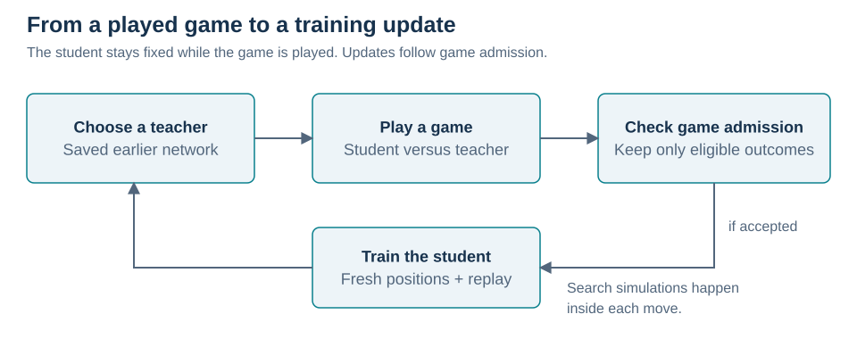

## The supplied generation 15 snapshot

The archive contains **official generations 1–15**. Generation 15 is an official teacher. The active student is numbered **16** by the trainer (`teacher_gen + 1`); that number does not mean it has passed promotion.

| Item | Archive contents or recorded metadata |
| --- | --- |
| Latest teacher | Official generation 15 |
| Active student | Candidate generation 16, by the trainer's numbering |
| Recorded training episodes | 79,191 |
| Completed optimizer updates | 143,432 |
| Recorded learning rate | `0.00003` |
| Older teachers | Generations 1–9: value-only networks, 8 input planes |
| Newer teachers | Generations 10–15: residual policy and value networks, 72 input planes |
| Current input | 8 positions × 9 planes, shape `(72, 9, 9)` |
| Current policy output | 209 action scores |
| Recorded stored replay | 119,541 positions across 15 teacher partitions |

The generation inventory comes from the archive's two `NN architecture.json` manifests. Counters come from its `gen 10-15/quorinet_meta.json`. These are recorded snapshot facts, not playing-strength measurements. The episode counter includes opening games, continuation games, and games stopped at the move limit. The training bundle is authoritative when resuming; the JSON file is a readable summary.

The older workspace folders still stop at `gen 10-14`. To use generation 15, use the complete collection inside the supplied archive. This README does not replace those folders.

## Terms used throughout

| Term | Meaning in this README |
| --- | --- |
| **Position** | Pawn locations, placed walls, remaining wall counts, and whose turn it is. The engine also records move count and history. |
| **Ply** | One action by one player. Two plies usually give each player one turn. |
| **Action** | One legal pawn move or wall placement. |
| **Student** | The network whose parameters are updated during training. |
| **Teacher** | A saved earlier network used as an opponent. Its searched actions can also supply policy targets. |
| **Latest teacher** | The most recently promoted official teacher: generation 15 in this snapshot. |
| **Opening game** | A training game starting from the standard initial board. |
| **Continuation game** | A new training game starting from a saved nonterminal position and played to its own result or cutoff. |
| **Search simulation** | One traversal and value backup inside Monte Carlo tree search; not a completed training game. |
| **Policy target** | The stored action distribution: search visit proportions for a policy-capable model, or a one-hot searched action for a value-only teacher. |
| **Fresh positions** | The pre-action positions from the newly accepted game, including both players' turns. |
| **Replay** | Training again on positions from previously accepted games. |
| **Replay span** | Up to eight consecutive stored positions from one replay game, sampled together. |
| **Teacher-weighted replay** | Replay that chooses a teacher using win-rate-based weights before choosing that teacher's replay spans. The source calls these `priority` slots. |
| **General replay** | Replay across the available spans without first weighting teachers. |
| **Tactical setup weighting** | Extra loss weight on positions preceding a maintained race lead, or its weakening or reversal, using the rule in Section 11. |
| **Promotion** | Installing the student as the next official teacher after it passes the promotion test. |

## 1. Quoridor rules and distances

Quoridor uses a 9×9 board. Player 1 starts at `(4, 8)` and aims for row 0. Player 2 starts at `(4, 0)` and aims for row 8. Each starts with ten walls. On each turn, move your pawn or place one wall. The first player to reach their goal edge wins.

A pawn normally moves to an orthogonally adjacent square if no wall blocks the edge. If the opponent occupies that square, a straight jump is legal when the square beyond the opponent is reachable. If a wall or board edge blocks that straight jump, eligible sideways moves around the opponent are legal instead. Pawns cannot share a square.

A wall spans two neighboring board edges. Its anchor uses an 8×8 grid. A placement is rejected if it overlaps another wall, crosses another wall, or leaves either player without a route to the goal. **All rules-legal walls reach search**; a wall need not delay a pawn immediately.

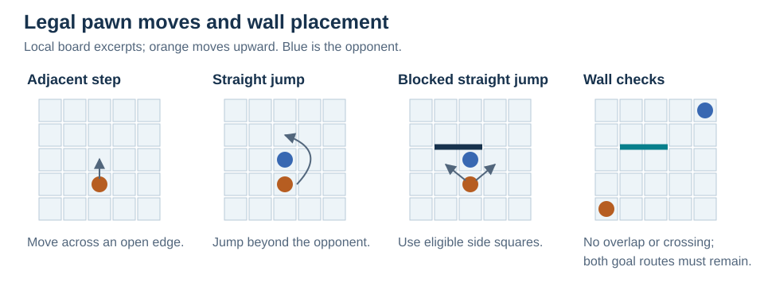

| Distance | What it measures | Use |
| --- | --- | --- |
| **Shortest-path distance** | Fewest adjacent board steps to the goal with the current walls; ignores the opponent pawn and jumps. | Input features, action ordering, wall reachability, continuation phase. |
| **Shortest-move distance** | Fewest legal pawn moves, including jumps, while holding the opponent at its current square. | Race estimate and tactical setup weighting. |

For wall legality, the engine caches board connectivity and a route for each player. If a proposed wall misses a cached route, that route proves reachability. If it cuts that route, reachability is checked again. This speeds up the check without removing legal walls.

**Source:** [distance and reachability functions](Quoridor.py#L464); [`get_shortest_move_dist`, `get_valid_moves`, `is_valid_wall`, `generate_actions`](Quoridor.py#L1185).

## 2. Network input and player perspective

The current network receives the present position followed by the seven preceding positions, newest first. Each contributes nine 9×9 feature planes. Concatenating them produces a **`(72, 9, 9)`** input. A missing position contributes nine zero planes.

| Plane within each position | Contents |
| --- | --- |
| 1–2 | Active and opponent pawn locations: one 1 per plane |
| 3–4 | Horizontal and vertical wall anchors: binary values in the upper-left 8×8 area |
| 5–6 | Active and opponent walls remaining, each divided by 10 |
| 7–8 | Active and opponent shortest-path distances, each divided by 81 |
| 9 | Total plies already played, divided by 200 |

Scalar values in planes 5–9 are repeated over the entire plane. **Active player** means the player to move at the position being evaluated. Every preceding position uses that same player's perspective, even when the other player was to move in the preceding position. History follows the actual game and is carried into a continuation game.

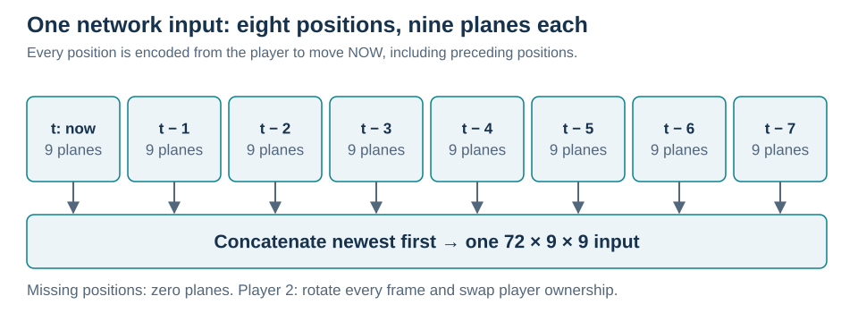

Player 1's coordinates stay unchanged. For player 2, the encoder rotates the board by 180 degrees and swaps player ownership. A pawn at `(c, r)` becomes `(8−c, 8−r)`; a wall anchor becomes `(7−c, 7−r)`. The active player then always aims for row 0.

Horizontal reflection during training is a separate transform: a pawn column becomes `8−c`, while a wall-anchor column becomes `7−c`; rows stay unchanged. All eight positions within an input and its policy target receive the same reflection. The different coordinate ranges keep wall features aligned with wall-action targets.

**Source:** [the three input encoders](Quoridor.py#L542); [`policy_action_index` and `mirror_policy_batch`](Quoridor.py#L409); [`mirror_state_batch`](Quoridor.py#L87).

## 3. The policy and value network

A **convolution** combines nearby board features with learned filters. A **feature channel** is one resulting 9×9 map. A **residual block** learns a change to its input and adds that change back to the input.

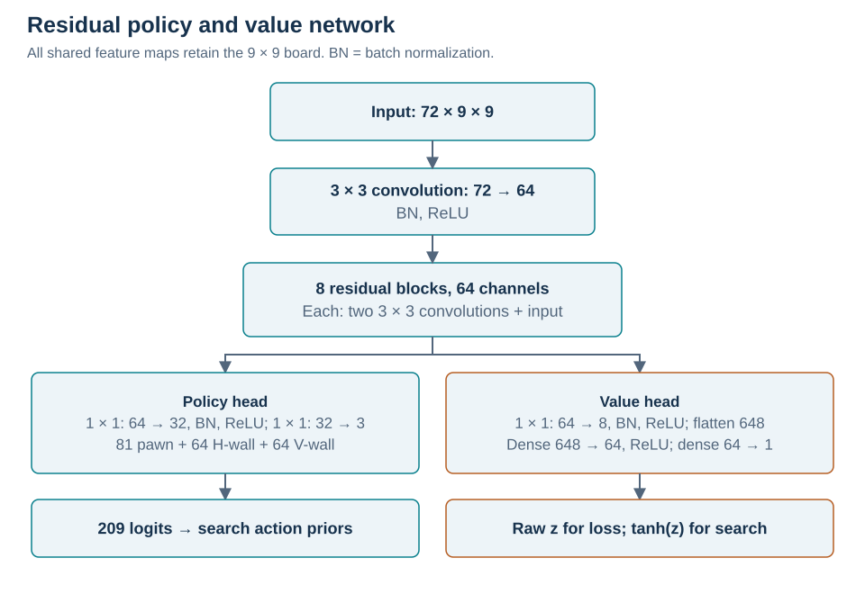

1. A 3×3 convolution maps 72 input planes to 64 feature channels, followed by batch normalization and ReLU. Batch normalization rescales feature activations; ReLU replaces negative activations with zero.
2. Eight residual blocks keep 64 channels and the 9×9 board size. Each block has two 3×3 convolutions with batch normalization. ReLU follows the first convolution and the final addition: `output = ReLU(input + convolution_branch(input))`.
3. The **policy head**, the policy output branch, uses a 1×1 convolution `64→32`, batch normalization, ReLU, and a 1×1 convolution `32→3`. It keeps the full pawn map and the upper-left 8×8 area of each wall map.
4. The **value head**, the position-value output branch, uses a 1×1 convolution `64→8`, batch normalization, ReLU, flattening to 648 numbers, a dense layer `648→64` with ReLU, and a dense layer `64→1` producing scalar `z`.

The policy produces **209 logits**: 81 pawn destinations, 64 horizontal wall anchors, and 64 vertical wall anchors. A logit is an unnormalized score. Search applies softmax only to actions surviving the rules and immediate-win checks, so illegal actions receive no search probability.

Search uses value **`tanh(z)`**, between −1 and +1. Positive favors the active player. Training uses raw `z` as explained in Section 12. The network processes each input independently and has no recurrent hidden state.

Generations 1–9 retain a value-only model: four convolution layers `8→32→64→64→64`, global average pooling, and dense layers `64→64→1` ending in `tanh`. Their saved encoders supply eight planes. The compatibility code also supports an intermediate two-head model, but the supplied manifests identify the official archives as the value-only and residual families above. These archives record model history, not a controlled architectural comparison.

**Source:** [`ResidualBlock` and `PolicyValueQuoriNet`](Quoridor.py#L318); saved architecture descriptions inside the supplied archive.

## 4. Search

The search method depends on the loaded model. This matters when the student faces an older teacher.

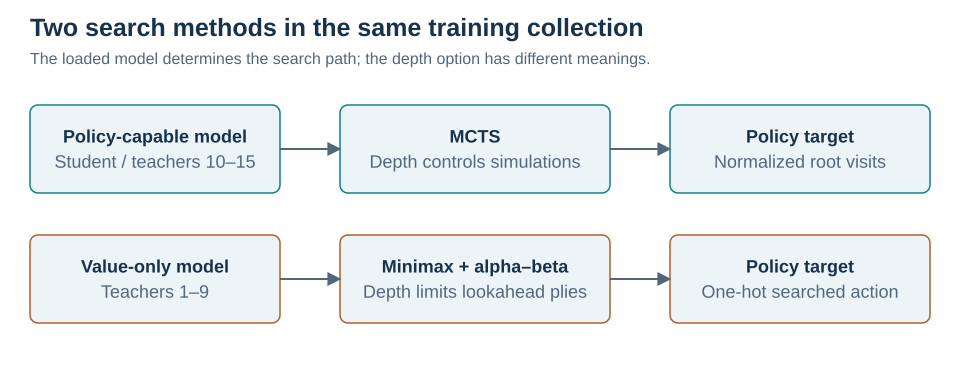

### 4.1 Monte Carlo tree search for policy-capable models

**Monte Carlo tree search (MCTS)** builds a tree of possible actions and replies. The root is the current position; a child follows one action. A leaf is an unexpanded position or one where expansion stops. This implementation estimates ordinary leaves with the network rather than playing random games to completion.

Each search simulation has three steps:

1. **Select:** follow actions through expanded positions. At the root, choose an unvisited action first, in descending prior order, until every root action has one visit.
2. **Expand and evaluate:** generate the leaf's actions, create children, and obtain its value.
3. **Back up:** add the value and one visit to each traversed position. Negate the value at each change of player: a favorable result for one player is unfavorable for the other.

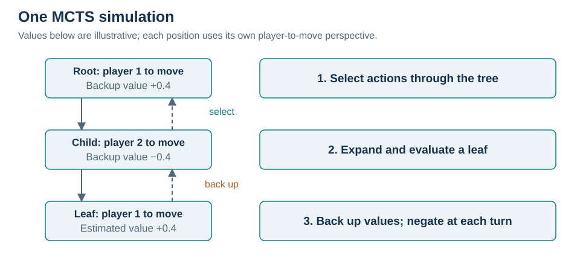

At every expansion, the **immediate-win checks** first restrict actions. If the active player can reach its goal immediately, only winning actions remain. Otherwise, if the opponent could win on its next move, search keeps actions preventing that win when any exist. If no defense exists, it keeps the available actions. A low policy score alone never removes an action or reply.

When a nonterminal position has at least one wall remaining, the network supplies its value and logits. Softmax converts the surviving action logits to **priors**, probabilities guiding exploration. Nonterminal root children needing the network are evaluated together in a batch. Predictions are reused only within this search, so later training cannot leave stale predictions for the next search.

After the compulsory root visits, action selection uses:

```text
Q − repetition penalty − race penalty
  + 1.5 × P × sqrt(max(1, N)) / (1 + n)
  + 0.5 × sqrt(log(1 + N) / (1 + n))
```

`Q` is the child's mean value negated into the parent's perspective, or zero for an unvisited child. `P` is the prior, `N` the parent's visits, and `n` the child's visits. One exploration term follows the prior; the other can favor an underexplored action even if its prior is zero. Only the root has a compulsory-visit guarantee.

For a pawn action, the repetition penalty uses earlier visits to its destination and is capped at 0.5. Wall actions have no repetition penalty. Repeated squares are discouraged, not prohibited.

When **neither player has walls left**, search uses a race estimate and uniform priors. For each player, it computes shortest-move distance `d` and arrival time `max(0, 2d − 1)` if that player moves next, or `2d` otherwise. The difference is converted into the active player's perspective, passed through `tanh(gap / 8)`, and clipped to `[-0.99, +0.99]`. A longer-route action also receives race penalty `0.1 × min(2, extra moves)`. Future pawn moves can change jump opportunities, so this fixed-opponent route calculation is an estimate.

Actual goal arrival returns +1 or −1 from the leaf's active-player perspective. At the 200-ply cutoff, an unfinished search leaf uses the network or race estimate. That estimate does not create a completed-game training label.

**Source:** [`get_move_and_eval` and `mcts_move`](Quoridor.py#L958); [`_tactical_candidates`](Quoridor.py#L1280).

### 4.2 Search budget, root visits, and policy target

For `K` root actions after the immediate-win checks and depth setting `D`, MCTS runs:

```text
S = max(64 × max(1, D), 2 × K) search simulations
```

The first `K` simulations visit every root action once. At least `K` further simulations remain for comparisons. At the standard opening, three pawn moves and 128 wall placements give `K = 131`. With `D = 2`, the base budget is 128 but the actual budget is **262**.

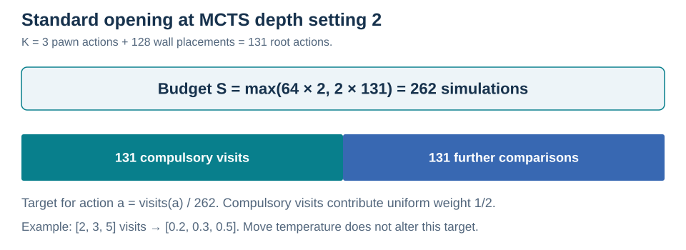

The policy target assigns each action its visit count divided by `S`. For example, counts `[2, 3, 5]` give target `[0.2, 0.3, 0.5]`; other output entries are zero. Compulsory visits create a uniform contribution with weight `K/S`. At this opening and budget it is one half. This is an arithmetic consequence, not a measured improvement.

Greedy selection chooses a most-visited action and resolves ties with the repetition penalty. Temperature sampling changes the played action but **never changes the stored visit-proportion target**.

For MCTS, depth is a simulation-budget control, not a fixed number of plies. Neural evaluations need not equal `S`: root children can be batched, predictions reused, and terminal or wall-free positions evaluated without the network.

### 4.3 Minimax for value-only teachers

A value-only teacher cannot supply policy priors. It uses **minimax with alpha–beta pruning**: look ahead a fixed number of plies, assume each side chooses its best available reply, and skip branches that cannot affect the choice. Here depth is a ply limit.

Each expansion generates legal actions, applies the immediate-win checks, scores the resulting positions, and normally keeps the top four. The four-action limit is not applied when the immediate-win checks restricted the actions. A candidate allowing an immediate opponent win receives a strongly unfavorable score.

With walls remaining, the ordinary nonterminal score is the teacher's bounded value multiplied by 100, converted into the requested player's perspective, minus repetition penalties. With no model or no walls remaining, it uses shortest-path distance and pawn progress instead. Returning to a square adds a penalty of 45 per earlier visit; repeating a board key adds 8,000. Goal arrivals receive terminal scores. These score scales belong to minimax; MCTS uses the bounded values above.

A searched value-only teacher action supplies a **one-hot policy target**: probability one on the chosen action. Its random-action compatibility path supplies no policy target. The normal training loop keeps teachers greedy, so that random-action path is not the normal teacher behavior.

**Source:** [`get_move_and_eval`](Quoridor.py#L958); [`rank_and_prune` and `evaluate_batch`](Quoridor.py#L1295); [`minimax`](Quoridor.py#L1445).

## 5. Exploration during training

An **exploratory game** enables random root priors for the student and visit-count sampling near the episode start. A **greedy game** disables both. Greedy does not mean deterministic: some search ties still use random ordering.

| Game | Student exploration | Teacher exploration |
| --- | --- | --- |
| Opening against the latest teacher | Alternates greedy/exploratory within each student seat, using its latest-teacher opening counter | Disabled |
| Opening against another teacher | Disabled | Disabled |
| Continuation game | Enabled | Disabled |
| Promotion test | Disabled | Disabled |

The exploratory student's root prior is `0.75 × prior + 0.25 × Dirichlet noise`, with concentration 0.3 per root action. This applies at each student search unless there is an immediate winning root action. Temperature 1 samples in proportion to visits during the **first 11 elapsed plies of the episode**. Afterward temperature 0 selects a most-visited action. **Root noise stays enabled** after those 11 plies. Continuation games count elapsed plies from their saved start.

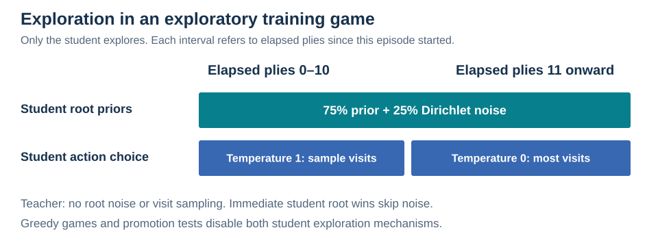

Exploratory openings can supply training data but do not enter qualification win rates. Continuation games also do not enter those rates. Opening and continuation games use separate counters to alternate the student's seat.

**Source:** [`reset_game`](Quoridor.py#L3075); [`_training_root_noise` and `_training_temperature`](Quoridor.py#L4802); [`mcts_move`](Quoridor.py#L1005).

## 6. Selecting the teacher to play

Each teacher's **qualification win rate** comes from a rolling log of at most 50 completed, greedy opening results. Student wins are 1 and losses 0. Cutoffs do not enter this log.

The base opponent probabilities allocate one quarter uniformly across loaded teachers and three quarters in proportion to relative-weakness deficits. The reference is the best observed qualification win rate. An observed teacher's deficit is `(best rate − its rate) / best rate`, bounded below by zero; when the best rate is zero, observed teachers get zero deficit. An unobserved teacher gets deficit 1. If every deficit is zero, probabilities are uniform.

Next, observed teachers below **58%** receive reserved probability. One or two such teachers each receive a reserved 45%; more share a reserved 90% equally. The remaining probability follows the base distribution. A reserved 45% is a minimum contribution, not necessarily the final probability.

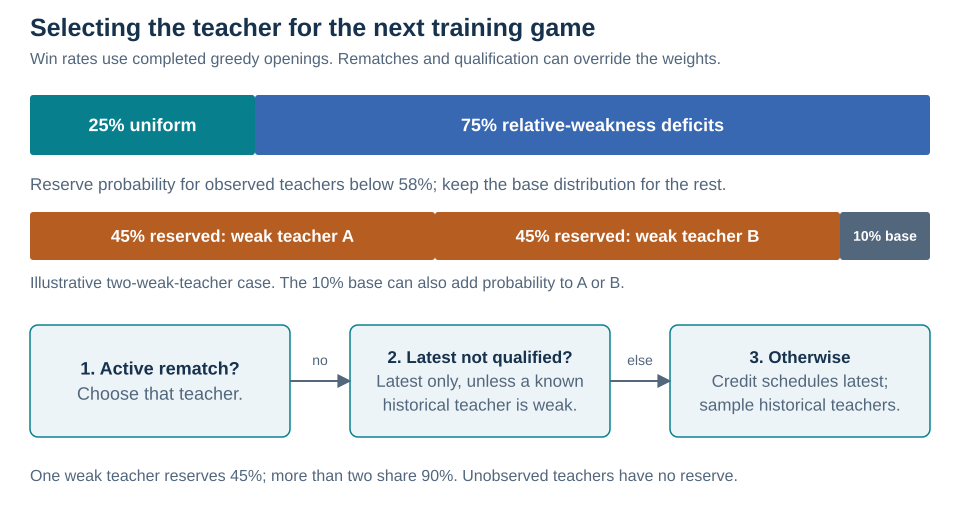

Selection applies these rules in order:

1. An active **rematch** selects that teacher. A decided opening loss starts a rematch; a decided opening win against it clears the rematch. Continuation results and cutoffs do not change it.
2. If the latest teacher lacks its 30-result, 57% qualification condition, play it exclusively unless a known historical teacher is below 58%.
3. Otherwise, a running credit counter schedules the latest teacher's share. On other selections, sample a historical teacher using the remaining weights.

These overrides mean displayed probabilities need not match a short run of games. The saved metadata has `rematch_teacher_gen = 15`, so a resumed run begins with that rematch rule in effect. The same teacher-selection function chooses continuation opponents, though continuation results do not change rematches or qualification logs.

Older recent/history allocation and escalation bookkeeping remain in the source. The active selection path recomputes live weights from qualification rates as above; those older allocation constants do not define its probability distribution.

**Source:** [`_generation_win_rate`](Quoridor.py#L2276); [`_refresh_opponent_weights` and `_select_training_opponent`](Quoridor.py#L2389); [`check_win`](Quoridor.py#L4455).

## 7. Continuation games

A continuation game starts at a saved position and plays forward to **its own result**. It can face a different teacher from the game that supplied the start. Only its newly played positions receive its outcome.

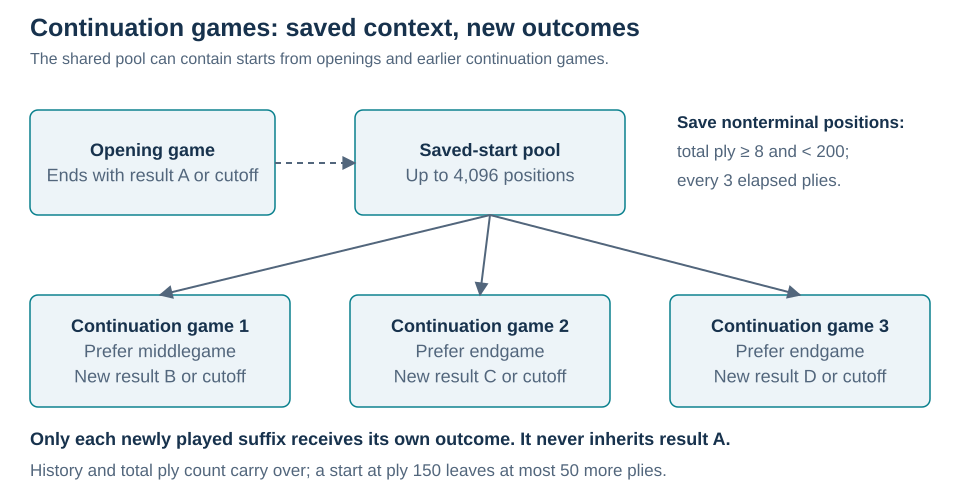

The engine saves a position when all these conditions hold:

- At least eight total plies have been played and fewer than 200.
- Neither player has reached its goal.
- Elapsed plies since this episode began are a multiple of three.
- Its position identity is absent from both the saved-start pool and recent used-start records.

**Position identity** includes the turn, both wall counts, both pawn locations, and placed walls. A board and its horizontal reflection share an identity. Move count and history are excluded from the identity, but retained in the saved snapshot.

The saved-start pool holds **4,096** positions, evicting its oldest entry when full. Selecting a start removes it and records its identity among at most **16,384** used starts. Once records are evicted, an old board can become eligible again.

Each ended opening replenishes a quota of **up to three continuation games**, including when the opening reached the cutoff. The first prefers middlegame starts; the next two prefer endgame starts. **Endgame** means either player's shortest-path distance is at most four; other starts are **middlegame**. Sampling is random within the preferred phase, falling back to any saved start. If no start is available, the next game is an opening.

This is a shared pool: the next three starts need not come from the immediately preceding opening. Continuation games also supply saved starts. Saving happens before game admission, so a start can come from a game whose training positions are later discarded.

Saved history, turn, repetition records, walls, and total ply count carry into the new game. The cutoff remains **200 total plies**. A start at total ply 150 allows at most 50 new plies. Earlier history provides input context; the earlier prefix is not relabeled with this game's outcome.

**Source:** [`get_position_key`](Quoridor.py#L929); [`_remember_start_position`, `_take_start_position`, `reset_game`](Quoridor.py#L3038); [`check_win`](Quoridor.py#L4455).

## 8. Which games supply training data

The student stays fixed during play. On each turn, the engine records the pre-action position using the student's encoder, whose turn it was, and the acting model's policy target when available. **Both student and teacher turns are recorded.**

Afterward, **game admission** decides whether to train:

| Game | Accepted for training |
| --- | --- |
| Completed opening against the latest teacher | Student win or loss |
| Completed opening against another teacher | Student loss only |
| Completed continuation against any teacher | Student win or loss |
| Unfinished game at the 200-ply cutoff | No |

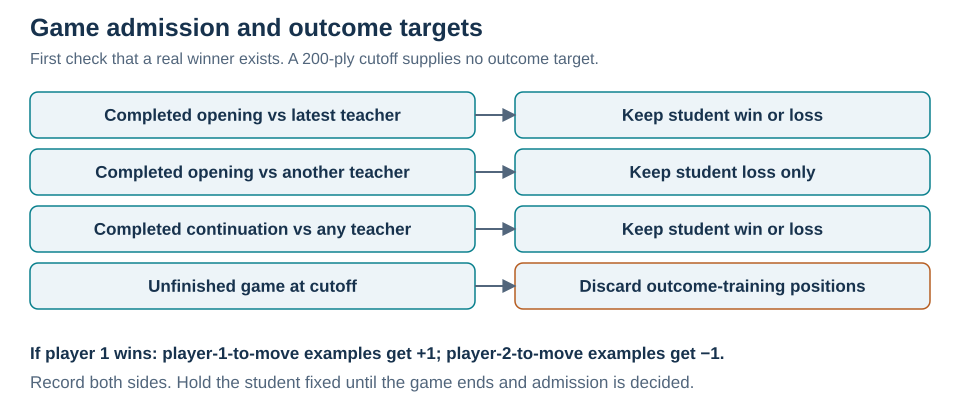

Each accepted position gets **+1 if its active player won, −1 if that player lost**. For a player-1 win, a player-1-to-move position gets +1 and a player-2-to-move position gets −1. The student's result is not copied unchanged onto both players' positions.

A teacher turn can supply the teacher's searched policy target while the actual game supplies its outcome target. Some older replay has outcome supervision without policy supervision.

An accepted game supplies its fresh-position pass before it is added to replay. It therefore cannot fill its own replay slots during that pass. Previously accepted wins remain in replay after their teacher becomes historical; the loss-only historical admission rule does not retroactively remove them.

**Source:** [`_commit_training_action`](Quoridor.py#L4443); [`train_step`](Quoridor.py#L4078).

## 9. Replay storage and replay spans

Replay is partitioned by the teacher faced in each game. Each partition holds up to **8,000 positions**, evicting whole oldest games when necessary. It does not truncate a game to reach exactly 8,000. Each stored example already has its full 72-plane input.

Each game is divided into **disjoint replay spans of at most eight consecutive examples**. A repeated position identity starts a new span. A replay span contains no duplicate identities and never crosses a game or teacher boundary.

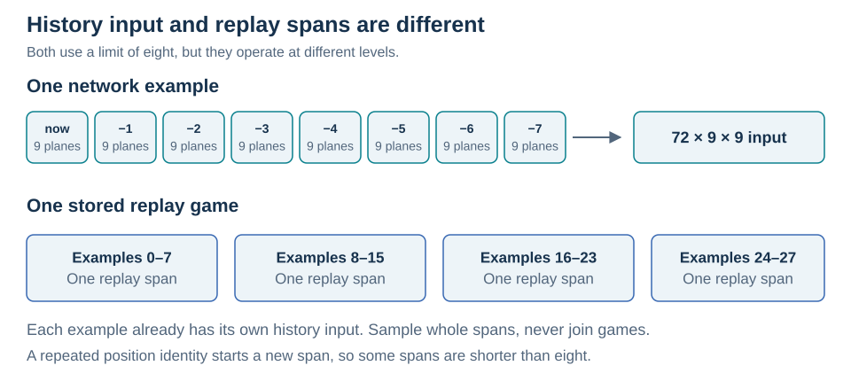

- **History input:** up to eight board positions form the 72 planes of **one** example.
- **Replay span:** up to eight consecutive **examples**, each with its own history input and outcome, are sampled together.

Replay spans do not construct new histories or train a recurrent model. Spans are shuffled as units during batch assembly. A replay draw rejects a span if it contains an identity already selected in the batch, or if the whole span cannot fit. Identity matching includes reflections and ignores history and move count. The fresh pass still includes every recorded fresh position, including repetitions; deduplication governs replay draws.

**Source:** [`replay_games_for_windows`](Quoridor.py#L624); [`_trim_replay`](Quoridor.py#L2754); [`_training_batches`](Quoridor.py#L2547).

## 10. Training batches

Normal batches request at most **256 positions**:

| Requested slots | Contents |
| --- | --- |
| Up to 176 | Fresh positions; unused slots become teacher-weighted replay |
| Up to 80 | General replay |

Fresh positions are divided into spans of up to eight and shuffled. Each batch takes at most 22 fresh spans (`176 / 8`). If `F` batches cover the fresh spans once, the routine requests **`2F` batches**: `F` for that fresh pass, followed by `F` replay-only batches using the same 176/80 allocation.

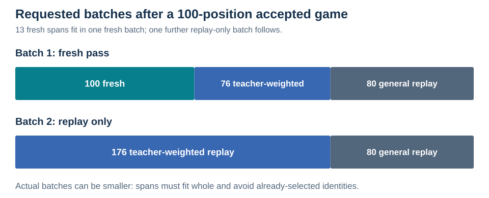

For a 100-position accepted game, 13 fresh spans require `F = 1`. Batch one requests 100 fresh, 76 teacher-weighted replay, and 80 general replay positions. Batch two requests 176 teacher-weighted replay and 80 general replay positions. Whole-span fitting, missing data, and duplicate rejection can reduce these numbers.

### 10.1 Teacher-weighted replay

Choose a teacher first, then one of its eligible spans. One quarter of teacher probability is uniform. Three quarters is shared in proportion to deficits `max(0, 0.57 − win rate)`. Unobserved teachers get zero deficit here. If no deficit is positive, replace 0.57 with the best observed rate and recalculate. If every deficit remains zero, teachers are uniform.

A large buffer therefore does not automatically dominate teacher-weighted replay. General replay has no teacher-first weighting, so its distribution can depend on the number of available spans.

### 10.2 Replay use counts

Within a draw, half the requested slots first favor spans with lower average use counts, breaking ties by newer game. Teacher-weighted replay applies that order within the chosen teacher. Remaining slots sample spans more broadly. Position use counts advance after a successful optimizer update, not merely after drawing data.

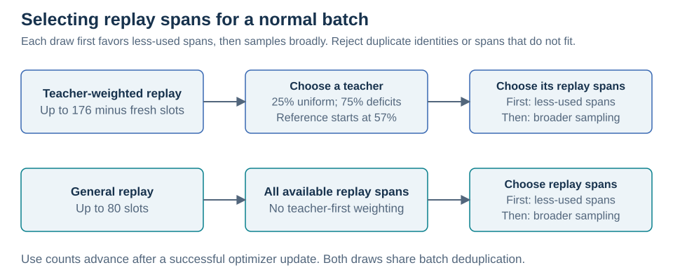

The **58%** threshold in Section 6 allocates new games. The **57%** threshold here allocates replay and also governs qualification. They are separate decisions.

### 10.3 Older one-time replay support

A separate one-time replay mode exists for the older temporary generation-10 training procedure. It samples only a requested teacher's games, requests up to 256 positions per batch, and checks full coverage before committing a completion marker. It does not automatically run during normal generation 15 training. `--temporary-ladder` requires teacher generation 9; it is not a generation 15 resume option.

**Source:** [`_replay_teacher_weights` and `_training_batches`](Quoridor.py#L2528); [`_run_startup_replay`](Quoridor.py#L4892); [`_configure_temporary_ladder`](Quoridor.py#L1721).

## 11. Tactical setup weighting

Tactical setup weighting gives selected examples **base loss weight 3**, versus weight 1 elsewhere. It changes training contribution, not search scores or game admission.

For each recorded pre-action position, compute the race arrival gap using shortest-move distances from Section 4. Convert the sign to player-1 perspective and compress into bands **`−2, −1, 0, +1, +2`**. Positive favors player 1; negative favors player 2. Magnitudes of two or more become two. A one-ply lead stays distinct from a lead of at least two.

Find runs of the **same nonzero band lasting at least four recorded plies**. For each run:

1. Mark up to six positions immediately before the run begins, provided at least two preceding positions exist.
2. If the next band weakens, removes, or reverses that lead, mark up to six positions immediately before that change, again requiring at least two preceding positions.

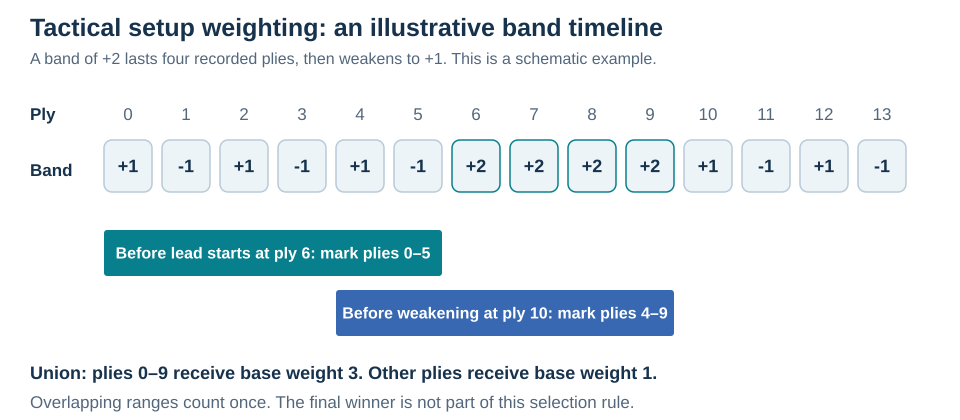

The favored player need not retain the lead until victory. The rule does not automatically weight the whole maintained lead. Positions inside that lead can be marked because they precede a later weakening or reversal. Overlapping marked ranges count once.

### Worked example: a strategy causes a maintained deficit

Here the **student is player 1** and the **teacher is player 2**. The teacher advances down column 6 while the student advances up column 0, then places a horizontal wall at **`(0, 3)`**. That wall blocks upward movement from row 4 to row 3 in columns 0 and 1. The student must move sideways to column 2 before continuing upward.

The wall increases the student's shortest-move distance from **4 to 6**, while the teacher's distance stays **4**. Including turn order, the race gap changes from **−1 to −3** in player-1 perspective. The band becomes **−2** and stays there for four consecutive recorded positions **6, 7, 8, 9**; in this example it continues through position 13. This is a maintained deficit for the student and the same maintained lead for the teacher.

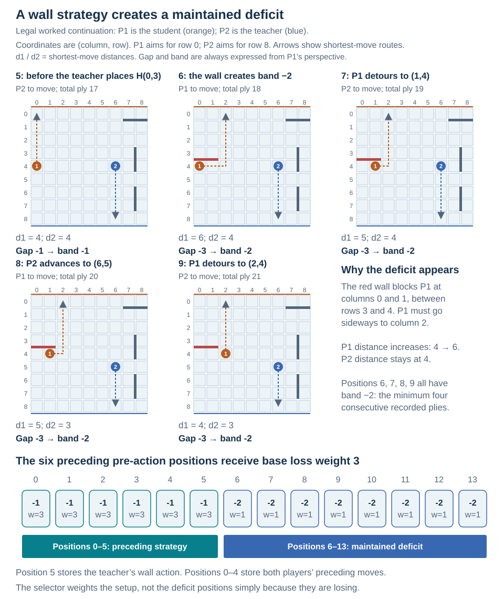

Position numbers refer to **pre-action positions within this continuation**, rather than the game's total ply count. The preceding strategy is concrete:

| Position | Player to act | Action stored with this position |
| --- | --- | --- |
| 0 | Student / P1 | Move `(0, 7) → (0, 6)` |
| 1 | Teacher / P2 | Move `(6, 2) → (6, 3)` |
| 2 | Student / P1 | Move `(0, 6) → (0, 5)` |
| 3 | Teacher / P2 | Move `(6, 3) → (6, 4)` |
| 4 | Student / P1 | Move `(0, 5) → (0, 4)` |
| 5 | Teacher / P2 | Place horizontal wall `(0, 3)`, forcing the detour |

The selector marks **positions 0–5 with base loss weight 3**, including the position storing the wall action. It marks both players' preceding choices; it does not isolate just the teacher's wall or label a strategy by name. Positions 6–13 retain base weight 1 in this example: being in a deficit is not by itself the weighting rule. A negative maintained band triggers the same setup selection as a positive maintained band.

This is a constructed legal continuation, checked using the source's movement, wall-legality, distance, and tactical setup selection functions. It starts at total ply 12, retains both goal routes, and can be played through to a teacher win. The earlier opening supplies context, but is outside this continuation's training trajectory. The diagram illustrates the selection rule rather than reporting a recorded training match.

The race lead is a heuristic based on current walls and fixed-opponent routes. A lead shorter than four plies does not qualify by itself. Its effect on playing strength still needs a controlled comparison.

**Source:** [`_tactical_replay_indices`](Quoridor.py#L2485); [`_fresh_sample_weights`](Quoridor.py#L2661).

## 12. Training objective and optimization

Each example is horizontally reflected with probability **0.5** before loss calculation. Its eight input positions and policy target receive the same reflection. Different examples in a replay span can be reflected independently.

Start with weight 3 for tactical setup examples and 1 for other examples. A mixed fresh/replay batch can increase fresh weights:

```text
fresh multiplier = max(1, min(4, sum(replay weights) / sum(fresh weights)))
```

This moves fresh contribution toward half the total weight, with a maximum fourfold multiplier. It never reduces fresh weights. A tiny fresh game is not guaranteed half the weight because of the cap. Batches with only fresh or only replay receive no such adjustment.

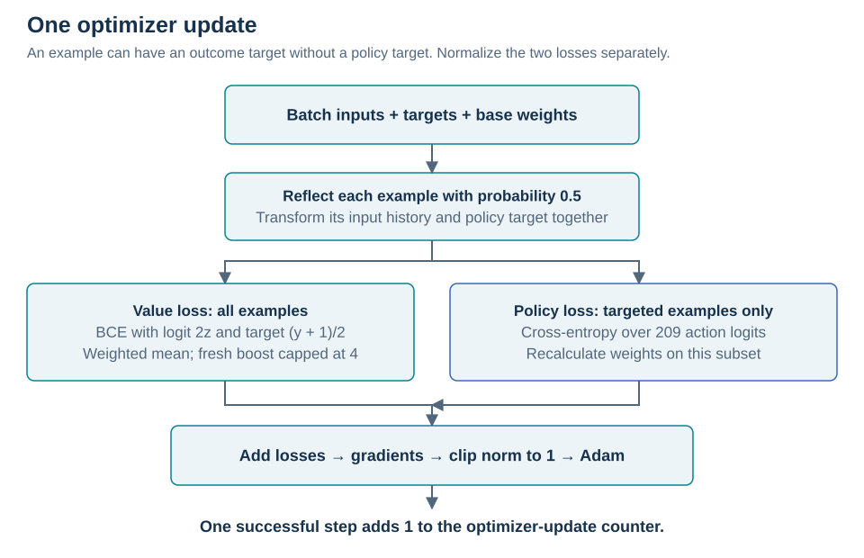

### 12.1 Outcome loss

For raw value `z` and outcome `y` equal to −1 or +1, calculate binary cross-entropy with **logit `2z` and target `(y + 1) / 2`**. The identity `(tanh(z) + 1) / 2 = sigmoid(2z)` connects this to the bounded value used during play. Working in raw-logit space avoids differentiating the loss through a saturated `tanh`. The value loss is the weighted mean over all examples.

Normal completed-game training uses the final winner directly. It does not discount outcomes by distance to the end, learn next-state temporal-difference targets, or assign zero-outcome targets to cutoffs. The isolated single-game diagnostic is a separate code path.

### 12.2 Policy loss

For examples with a policy target, calculate cross-entropy against the student's softmax over **all 209 logits**. Search masks actions when constructing the target; the training softmax covers the entire output space.

Recalculate fresh/replay balancing on this policy-supervised subset and take its own weighted mean. This matters when some examples have outcome targets but no policy targets. Total loss is **value loss + policy loss**, or just value loss when policy targets are absent.

### 12.3 Parameter update

Compute gradients, reject nonfinite losses or gradients, clip total gradient norm to **1**, and apply **Adam**. Each successful Adam step increments the optimizer-update counter once. Return the student to evaluation mode for play. Several batches can follow one accepted game; there are no updates between its moves.

**Source:** [`checked_value_loss`](Quoridor.py#L211); [`_fresh_sample_weights` and `_optimize_student_batch`](Quoridor.py#L2661); [`train_step`](Quoridor.py#L4078).

## 13. Learning rate

The production learning rate follows cumulative **completed optimizer updates**, not games, generations, or win-rate trends.

| Completed updates | Learning rate |
| --- | --- |
| Below 50,000 | `0.0001` |
| 50,000–149,999 | `0.00003` |
| 150,000–249,999 | `0.00001` |
| 250,000 onward | `0.000003` |

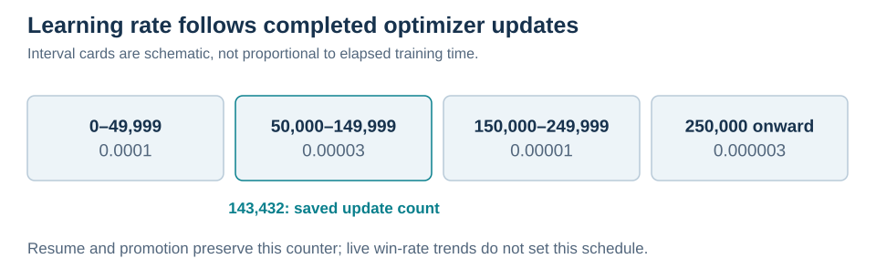

The counter survives ordinary resume and promotion. The schedule is applied immediately before and after each update. The snapshot's 143,432 updates belong to the second interval. Older tuning helpers and metadata remain in the source, but the normal game-completion path does not call those helpers. The manual learning-rate handler also reapplies this schedule.

**Source:** [`_apply_lr_schedule`](Quoridor.py#L2764); [`_optimize_student_batch`](Quoridor.py#L2675); [`_adjust_lr_manually`](Quoridor.py#L2796).

## 14. Promotion

Automatic promotion uses **rolling qualification**, followed by a **promotion test** with fixed networks:

- The latest teacher needs at least **30** qualifying opening results and at least **57%** student wins.
- Every other loaded teacher needs a nonempty qualification log with at least **57%** student wins. Thirty results are not required for those teachers.
- An active rematch must be cleared before testing starts.

A displayed trend is informational, not an extra qualification condition. A manual test request can bypass rolling qualification but still waits for the eligible opening-game completion path and a cleared rematch.

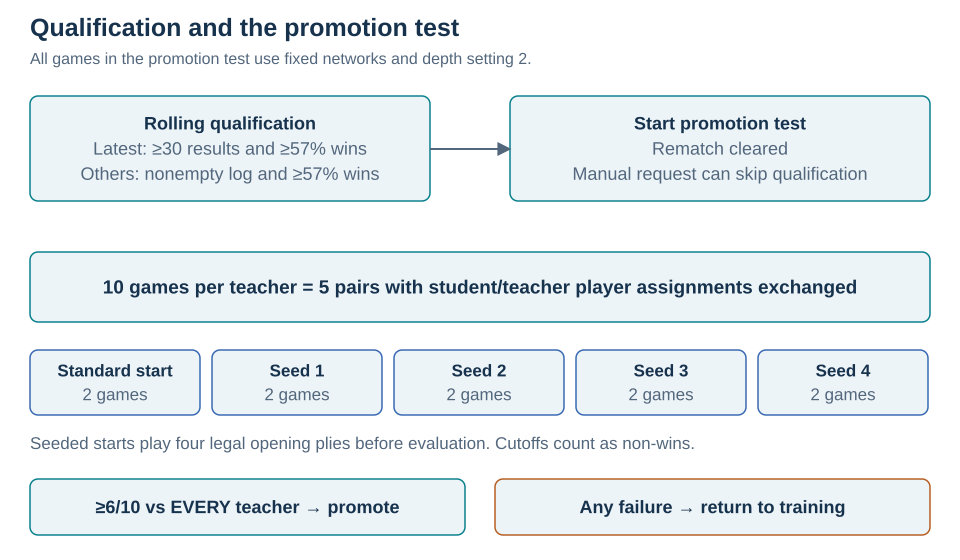

The test uses **ten games per distinct loaded teacher**, at depth setting **2** even when training uses another setting. For policy-capable models this is the MCTS budget rule; for value-only teachers it is minimax depth two. No training updates occur during testing.

The ten games form five pairs with exchanged student/teacher player assignments. Pair one uses the standard opening. Pairs two through five use seeds **1, 2, 3, 4**, each generating the same four legal opening plies within its pair. The physical board and goal edges keep their usual definitions.

Passing requires **at least six wins out of ten against every teacher**, the smallest integer meeting 57%. A cutoff is a non-win. Testing stops early if even winning every remaining game cannot reach the required total against a teacher.

On success, copy the student into the next official teacher, update the pool, and reset qualification logs. The student, optimizer state, replay, and accumulated update counter continue. A manual snapshot alone does not promote a model.

On failure, return to training. Replace the failed teacher's qualification log with its actual test results; append results for tested teachers that passed; retain logs for untested teachers. This changes the evidence used before another automatic test.

Promotion selects checkpoints within the training pool. It is not an external Elo rating or a sufficient final playing-strength benchmark.

**Source:** [`_all_training_gates_met`](Quoridor.py#L2303); [`play_eval_game` and `run_final_promotion_test`](Quoridor.py#L3836); [`_install_promoted_student`](Quoridor.py#L4026); [`check_win`](Quoridor.py#L4455).

## 15. Checkpoints, compatibility, and resume

Keep the complete collection together. Architecture archives store official teachers and manual snapshots with their network definitions and input encoders. The active training bundle stores the student, latest teacher, optimizer, replay and use counts, saved starts and used-start records, continuation quota, counters, and random states.

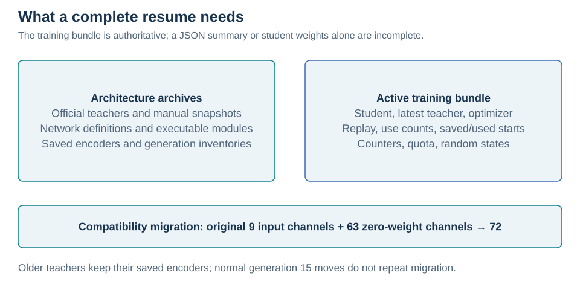

`quorinet_training_state.pth` is authoritative when present. Separate weights and the JSON summary do not replace all of its contents. Sidecar fallbacks are supported, but they do not restore a full replay/continuation state when that state is absent.

Older teachers retain their saved encoders. A supported nine-plane-to-72-plane migration copies the original nine input-channel weights and fills the other 63 channels with zero. Corresponding Adam moment tensors are widened the same way. This preserves the initial response when the original nine input planes are unchanged. Legacy replay migration reconstructs history within each complete game and converts frames to the current player's perspective. These are compatibility paths, not stages repeated on every generation 15 move.

The normal bundle preserves training state between games; the older temporary training procedure also supports paused game sessions. Restored random states take precedence over a fresh seed. Initialization can migrate or reorganize files, so use a working copy of a transferred collection when preserving the original archive.

**Source:** [`upgrade_history_weights` and `upgrade_history_optimizer`](Quoridor.py#L387); [`history_replay_games`](Quoridor.py#L595); [`load_checkpoint_if_exists`](Quoridor.py#L3276); [`_training_bundle`](Quoridor.py#L3715).

## Setup and use

Extract `10.15 gen 15.zip` into a separate working directory. Keep `Quoridor.py`, `play.py`, `gen 1-9/`, and `gen 10-15/` together there. These commands are usage examples, not training or benchmark runs performed for this revision.

The dependencies are **PyTorch** and **Pygame**:

```powershell
python -m venv .venv
.\.venv\Scripts\Activate.ps1
python -m pip install torch pygame
```

Normal models are constructed on the CPU. `--threads` sets PyTorch's CPU thread count.

### Play against a saved model

```powershell
python play.py --play-depth 4 --threads 4
```

The menu offers official teachers and manual snapshots. A manual snapshot is not automatically a promoted teacher.

| Control | Action |
| --- | --- |
| Click a legal square | Move your pawn |
| Click a legal wall location | Place a wall |
| `R`, Space, or right mouse button | Rotate wall preview |
| `F11` | Toggle fullscreen |

### Resume normal training

```powershell
python Quoridor.py
```

Or run a requested number of episodes without the window:

```powershell
python Quoridor.py --headless 100 --threads 4 --train-depth 2
```

`--headless 100` counts ended episodes, including continuation games and cutoffs, rather than 100 standard-start completed games. In headless mode, `p` toggles pause, `s` requests saving, and `q` requests exit; ordinary training finishes its current game before exiting.

| Option | Meaning |
| --- | --- |
| `--train-depth D` | MCTS base budget `64 × D`, raised for root visits; minimax ply limit for value-only teachers. Default 2. |
| `--play-depth D` | Corresponding control for human play. Default 4. |
| `--threads N` | CPU threads; default at most 4. |
| `--seed N` | Seed a fresh run; resume restores saved random states. |
| `--checkpoint-dir PATH` | Working load/save directory; supply a complete collection. |
| `--train-updates N` | Deprecated and ignored by normal training. |

## Check implementation and playing strength

The existing tests cover history, migration, search, replay, continuation games, teacher guidance, learning-rate intervals, archives, and resume:

```powershell
python -B -m unittest discover -p "test_*.py"
```

Some tests update temporary models. Passing them would check implementation behavior, not the saved student's strength. This revision inspected source and archive metadata without training, loading saved networks, or reporting new match results.

A read-only comparison can be run from the extracted generation 15 collection:

```powershell
python check_promotion.py --candidate 15 --opponents 9 14 --games 100
```

This tool uses 100 games per opponent, exchanged player assignments, paired opening seeds, depth setting 2, and overall/seat-specific results. It bypasses the application constructor and writes no checkpoints. It compares **official generation 15**, not the active candidate generation 16. No result from this example is claimed here.

External strength evaluation should freeze checkpoints and search settings, use opponents outside the training pool, and report wins, draws, losses, and uncertainty by seat over paired openings. Record hashes, seeds, hardware, budgets, and termination rules. The same depth number does not imply equal compute for MCTS and minimax. Keep final evaluation separate from checkpoint selection.

To measure history input, compulsory root visits, continuation games, teacher-weighted replay, game admission, or tactical setup weighting, compare separately trained variants with matched budgets and multiple seeds. Removing a feature only during play and retraining without it answer different questions. Training loss and generation numbers are not external strength evidence.

## Files in the supplied archive

```text
Extracted generation 15 collection/
├── Quoridor.py                  Rules, encoders, models, search, training, promotion
├── play.py                      Human-play client
├── check_promotion.py           Read-only official-checkpoint comparison
├── test_*.py                    Implementation tests
├── gen 1-9/                     Value-only teachers and saved architecture
├── gen 10-15/                   Residual teachers, manual snapshots, active bundle
│   ├── NN architecture.json     Architecture, encoder, and generation inventory
│   ├── NN architecture.py       Saved network definition
│   ├── NN architecture.pt       Archived executable neural network
│   ├── gen 15.pth               Official generation 15
│   ├── quorinet_student_weights.pth
│   ├── quorinet_optimizer.pth
│   ├── quorinet_training_state.pth
│   └── quorinet_meta.json        Readable training-state summary
└── ...                          Older recovery and diagnostic files
```

The archive source SHA-256 is:

```text
d82aa147104477381ddd92fb4920dbdd1dd311909529aadf3830db6a029725ff
```

Source links point to the identical workspace `Quoridor.py`. Generation 15 checkpoint/metadata descriptions refer to ZIP contents, not the older workspace collection. Illustrations are editable SVG files in `assets/readme-gen15/`. Numerical walkthroughs and timelines are explanatory examples, not measured training or benchmark results.

## Further reading

The policy/value/search combination, residual blocks, replay, and Adam are established ideas. The terms above describe the implementation's particular choices without new names for those processes.

- [AlphaZero](https://arxiv.org/abs/1712.01815): policy and value learning with search.
- [Residual networks](https://arxiv.org/abs/1512.03385): residual connections.
- [Adam](https://arxiv.org/abs/1412.6980): the optimizer.

<!--
Authorship note, recorded from Ochir Erdembileg's account:
Ochir Erdembileg conceived the project's ideas and technical direction and authored
the commit history
Erkhes Unentugs contributed batching and proposed that the teacher shouldn't have exploration.
This refers to the project's design and development, not authorship of established
methods such as neural networks, residual networks, or Monte Carlo tree search.
The supplied working folder contains no Git history, so the commit count has not
been independently verified here. This comment is hidden from the rendered README
but remains readable in the Markdown source and is not private.
-->
