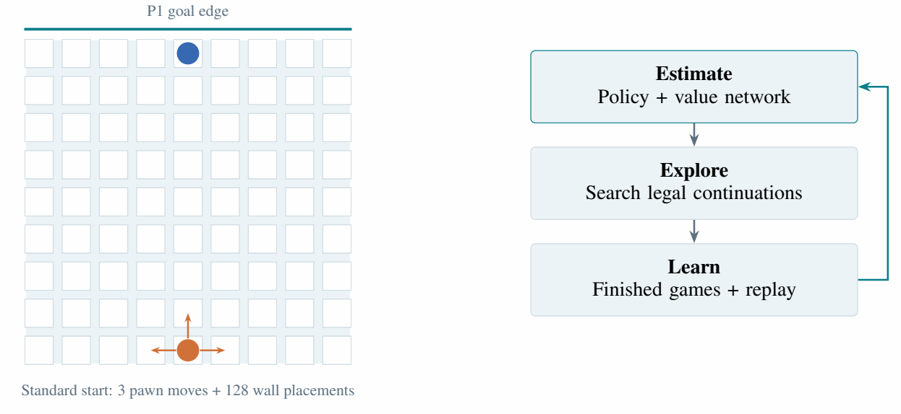
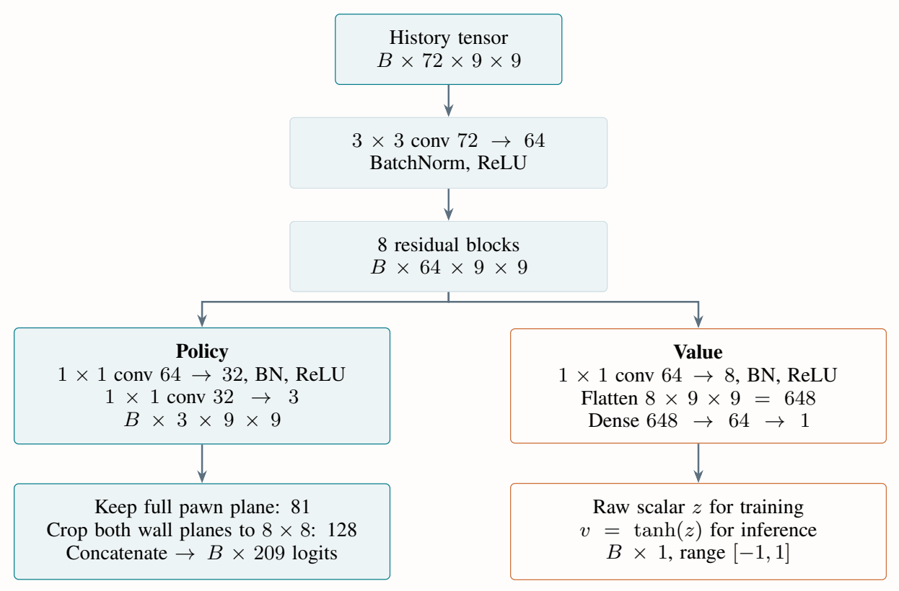
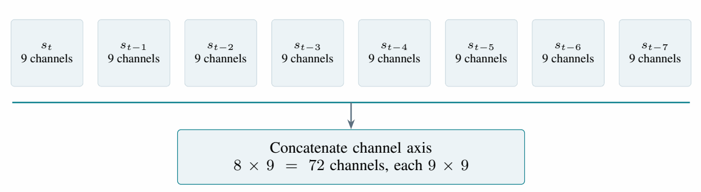
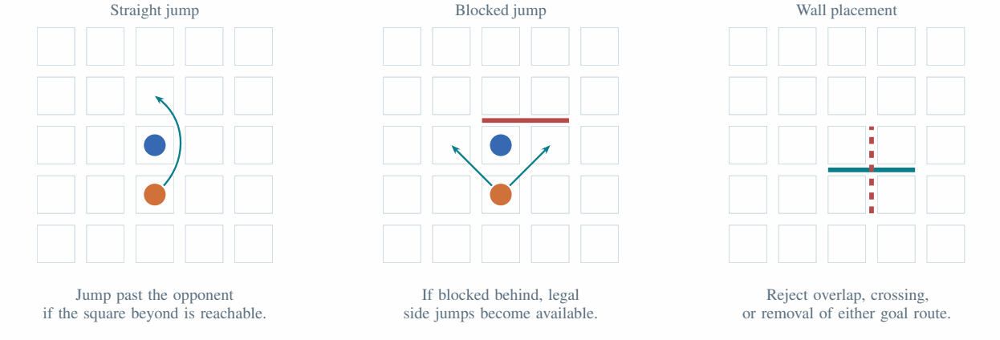
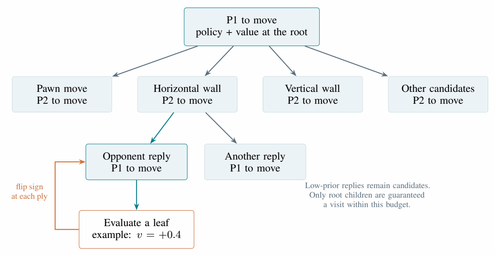
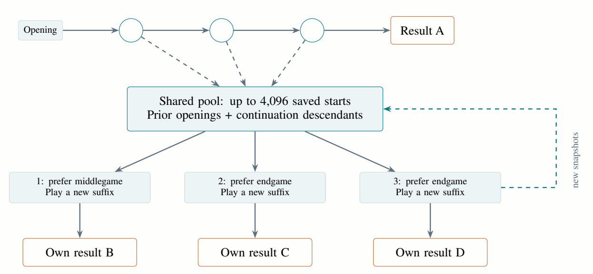
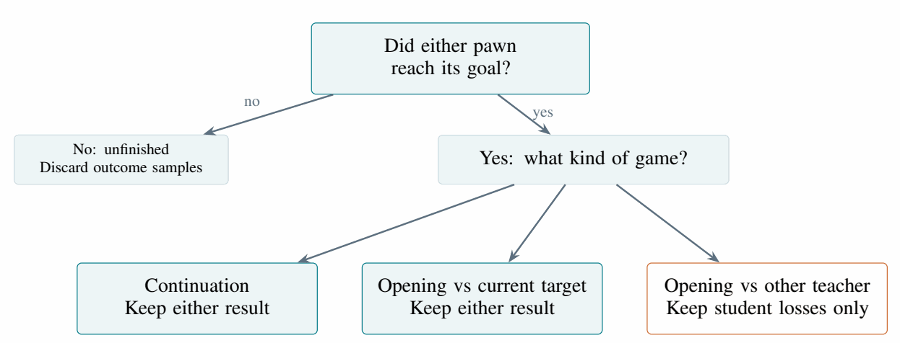
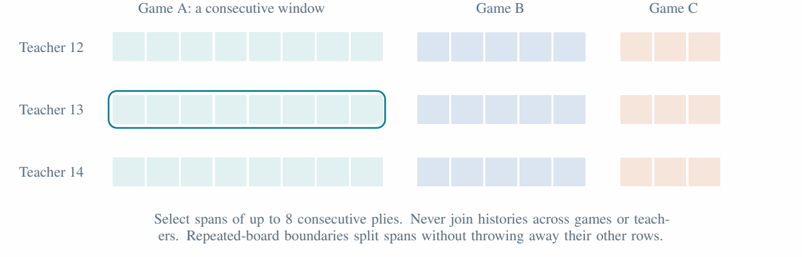
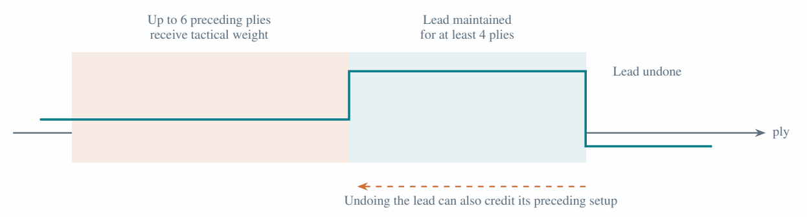
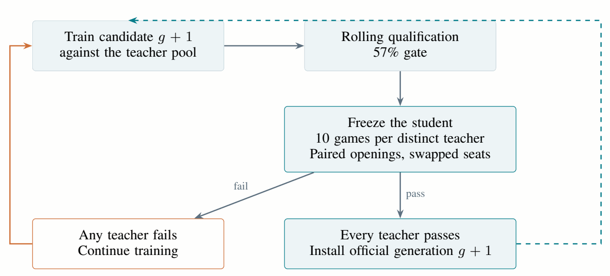

# QuoriNet

A Quoridor engine that learns through games against earlier versions of itself. A residual neural network suggests moves and estimates positions; Monte Carlo tree search tests those suggestions; completed games and replay teach the next student.

The part I wanted to explore was how to keep that learning useful: give low-priority moves a chance in search, return to opponents the student still struggles with, and start new games from positions it has already reached.

**[Read the illustrated paper](README.pdf)** · **[Play locally](#play-against-the-bot)** · **[Resume training](#resume-training)**



Quoridor is played on a 9×9 board with ten walls per player. Reach the opposite edge first. Each turn, either move your pawn or place a wall to lengthen the other player's route. Every wall must leave both players a path to their goal. The interesting decision is whether the delay you impose is worth spending a turn standing still.

QuoriNet was prepared for open-source release on 12 October 2026. I plan to keep maintaining the project and committing updated weights as training progresses.

## Download weights

Download the latest pretrained weights from [Google Drive](https://drive.google.com/drive/folders/1ZH1Fax6PrfDrHTMOZihURBQoL376pk-G?usp=drive_link).

For a complete training resume, download the full checkpoint collection and place the `gen 1-9` and `gen 10-14` folders beside `Quoridor.py`.

## How it works

The basic policy–value–search loop follows the approach used in AlphaZero. The network does two jobs:

- **Policy:** which pawn moves and wall placements look worth investigating?
- **Value:** how favorable is this position for the player whose turn it is?

Search uses both predictions to explore possible replies. Its root visit distribution becomes the next policy target. When a game finishes, the winner provides an outcome label for each stored position, from that position's active player's perspective.

The learning loop is:

1. Choose a historical teacher and play a game with the current student.
2. Store eligible positions, the search's move distributions, and the completed game's result.
3. Train on newly accepted positions and replay from earlier games.
4. Start additional games from saved positions, each played to its own result.
5. When the student qualifies, freeze it for a separate promotion test. A passing student joins the teacher pool.

A **teacher** here is a saved earlier checkpoint. It supplies an opponent, and where available, searched move targets. The training data comes from the engine's own games.

### The network

A 3×3 convolution maps the input to 64 feature channels. Eight residual blocks keep the board at 9×9, then separate spatial policy and value heads produce the outputs.



The policy has **209 logits**: 81 pawn destinations, 64 horizontal wall anchors, and 64 vertical wall anchors. This is the fixed output space; only currently legal actions take part in search. In the standard opening, 131 actions are legal: three pawn moves and 128 wall placements.

The value head produces a raw scalar `z`. During inference, `tanh(z)` gives a value between −1 and +1 from the player-to-move's perspective. During training, the outcome loss operates on the raw logit.

The archives also preserve the development history. Generations 1–9 use an earlier value-only network. A two-head convolutional model remains in the compatibility code, and the newer archives use the residual policy and value model. These families record how the implementation changed; their existence does not establish which architecture is stronger under equal training budgets.

### Giving it recent history

A board position shows where the pawns are, but recent movement can help distinguish a useful backtrack from a loop. The current input contains the present position and seven preceding positions.



Each frame has nine planes:

| Planes | Feature | Representation |
| --- | --- | --- |
| 1–2 | Active and opponent pawn positions | One-hot squares |
| 3–4 | Horizontal and vertical wall anchors | Binary |
| 5–6 | Active and opponent walls remaining | Wall count divided by 10 |
| 7–8 | Active and opponent shortest-path distances | Distance divided by 81 |
| 9 | Total moves already played | Move count divided by 200 |

Every frame uses the **current player's perspective**, including the older frames. Missing history is zero-filled, and a history never crosses game boundaries. Training reflects examples horizontally with probability 0.5, applying the same reflection to all eight frames and the policy target. Pawn squares and wall anchors use different coordinate ranges, so their transforms must agree with the action encoding.

Older teachers retain their saved encoders. A compatible nine-channel policy and value model can be expanded to 72 channels by copying its existing input weights and filling the additional channels with zeros. Its initial prediction is preserved at that migration point; later training can learn to use the history.

### Search: let the network suggest, then check

The rules engine constructs legal actions before the policy ranks them. Pawn moves include straight jumps and eligible diagonal moves around a blocked jump. Wall placement rejects overlaps, crossings, and any placement that removes either player's path to the goal.



A search simulation walks down a tree of possible moves, evaluates a leaf, and backs the estimate up through the visited nodes. Each move changes the player perspective, so the value changes sign at every backed-up ply.



The policy guides exploration, but a low prior should not make a legal move disappear. At the root, the search visits every candidate before revisiting one. For depth setting `d` and `K` candidates after tactical filtering, the simulation budget is:

```text
simulations = max(64 × max(1, d), 2 × K)
```

The `2 × K` floor leaves at least one simulation per candidate and an equal number for further comparisons. With `--train-depth 2`, the standard opening gets **262 simulations**, because its 131 candidates exceed the requested base budget of 128. The depth option is a simulation-budget control, rather than a fixed number of plies.

After root coverage, selection balances estimated value, policy-guided exploration, an additional exploration term independent of the policy, and bounded repetition and race penalties. Low-prior replies remain candidates deeper in the tree, although only the root has a guaranteed visit for every candidate. Root-child neural evaluations are batched.

Immediate wins and defenses against an immediate opponent win receive tactical filtering. When neither player has walls left, search uses jump-aware legal route lengths and turn order to estimate the race, with uniform action priors. That estimate stays inside ±0.99; an actual terminal win has magnitude one. Later movement can change jump opportunities, so the race estimate is still an estimate.

The normalized root visit counts become the policy target. Sampling temperature changes which move is played without changing that stored target. A search stopped at the move limit bootstraps a value; it does not turn an unfinished game into a completed outcome label.

## Where the training effort goes

The main choices in this project concern which games to play and which experience to learn from: historical opponents, continuations from reached positions, and replay organized by teacher and game.

### Return to difficult opponents

The student plays a pool of saved teachers. Live opponent selection combines a uniform component with a component based on relative weakness, weighted 25% and 75%. Teachers against which the student's observed win rate is below **58%** receive reserved probability: one or two weak teachers each receive 45%; larger weak sets share 90%. The remaining probability follows the base distribution. Rematch and qualification rules also affect the schedule.

Replay has a related but separate choice: its priority component selects a teacher before selecting that teacher's game spans, with weighting toward teachers below the **57%** gate. A teacher's large buffer therefore cannot dominate priority replay merely because it contains more positions.

The 58% live-opponent threshold and 57% promotion/replay threshold serve different purposes.

### Play new games from positions already reached

Always restarting at the empty board spends much of the search budget reaching familiar openings. QuoriNet saves playable states and uses them as starts for additional games.



One opening replenishes a quota of up to **three continuation games**. The shared pool holds up to **4,096 nonterminal states**, including their history. States become eligible after eight total plies and are sampled every three plies relative to the episode start. The first continuation prefers middlegames; the next two prefer endgames. If a preferred phase is unavailable, another eligible saved phase can be used.

Each continuation is played forward to **its own result**. Only the new suffix receives that result. A continuation never inherits the winner of the game that supplied its starting position. Positions reached in continuations can supply future starts too.

These are completed training games, separate from the temporary branches explored inside MCTS. Continuations supply learning data but do not count toward full-game qualification statistics. Games unfinished at the 200-ply cutoff receive no outcome-training label.

### Decide which completed games to keep

The admission rule depends on where a game started and which teacher the student faced:

| Game | Retained for outcome training |
| --- | --- |
| Opening against the current curriculum teacher | Either completed result |
| Opening against another historical teacher | Student losses |
| Continuation from a saved position | Either completed result |
| Unfinished game at the move limit | No outcome label |



This makes the training distribution selective. Results against the same teacher pool have to be interpreted with those admission and sampling choices in mind.

For policy-capable teachers, searched moves can supply their full visit distribution. Value-only teachers can supply a one-hot target for a searched action; random actions from those teachers do not provide policy supervision. Some older replay examples consequently have an outcome label without a policy target.

### Replay consecutive spans

Replay keeps up to **8,000 positions per teacher**. When a partition exceeds the budget, whole old games are removed. Samples use consecutive windows of at most eight plies, preserving the history within each game.



Each accepted fresh position gets one pass, followed by the same number of batches filled from replay. These batches allocate up to 176 positions to fresh data and priority replay, and 80 to general replay. The separate replay-only routine used by startup replay draws up to 256 positions from the selected teacher's pool. Available spans and deduplication can reduce the actual batch size.

Within a replay mode, half the requested slots favor less-used spans, breaking ties by recency; the rest sample more broadly. Use counts advance after a successful optimizer step. In mixed batches, fresh weights can be increased up to fourfold to bring their contribution toward half of the total weight. Value and policy supervision are balanced separately because some examples have only a value target.

### Give extra weight to tactical setup

An advantage may be created several moves before it becomes obvious. The training loss gives weight **3** to selected setup positions and weight **1** to other positions.



The selector looks for a jump-aware race lead maintained for at least four plies, or its weakening or reversal, and can credit up to six preceding plies. At least two preceding plies are required. This is a heuristic for assigning learning effort; controlled ablations are still needed to measure its effect.

### Optimization

The value objective is binary cross-entropy on `2z`, using the completed game's outcome from the stored state's player perspective. The policy objective is cross-entropy against the stored move distribution. Each is normalized over its own effective sample weights, and they are added when policy targets are available. Gradient norm is clipped to one before Adam updates the parameters.

The learning rate follows the total number of completed optimizer updates:

| Completed updates | Learning rate |
| --- | --- |
| Below 50,000 | `0.0001` |
| 50,000–149,999 | `0.00003` |
| 150,000–249,999 | `0.00001` |
| 250,000 onward | `0.000003` |

The counter survives resume and promotion. The stored 113,904-update checkpoint is in the second interval.

## When a student becomes a teacher

Promotion has two stages: rolling qualification, then a frozen test.



Rolling qualification requires at least **57% wins** over retained qualification logs. The current curriculum teacher needs at least 30 qualifying results; the other loaded teachers need nonempty logs meeting the same threshold. These logs use completed greedy opening games, excluding exploratory openings and continuations.

After qualification, training pauses and the student plays **ten frozen games against each distinct teacher**: one standard-opening pair and four seeded-opening pairs, swapping seats within each pair. Passing requires at least **six wins against every teacher**. Draws count as non-wins, and evaluation can stop early once passing is impossible.

A passing checkpoint enters the official pool. A failed test returns to training, using the failed teacher's frozen results to replace its qualification evidence. A generation number records progress through this curriculum. It is not an external strength rating, and the ten-game selection test is too small to serve as a final benchmark.

## Setup

Run commands from the project root, with both generation folders beside the source. The runtime dependencies are **PyTorch** and **Pygame**:

```powershell
python -m venv .venv
.\.venv\Scripts\Activate.ps1
python -m pip install torch pygame
```

If you already have a compatible Python environment, install the dependencies there. The current training code uses CPU tensors; the `--threads` option sets PyTorch's CPU thread count.

The checkpoint loader may migrate or reorganize saved files during initialization. Keep an archival copy of transferred checkpoints before opening them with changed source.

## Play against the bot

```powershell
python play.py
```

The menu offers the official teacher and saved manual students. The latest official teacher in this collection is generation 14. A manual student label describes a snapshot, without implying it passed promotion.

| Control | Action |
| --- | --- |
| Click a legal square | Move your pawn |
| Click a legal wall location | Place a wall |
| `R`, Space, or right mouse button | Rotate the wall preview |
| `F11` | Toggle fullscreen |

To choose the search budget:

```powershell
python play.py --play-depth 4 --threads 4
```

The same legal rules, search, network classes, and checkpoint loader are shared with the trainer.

## Resume training

Open the trainer:

```powershell
python Quoridor.py
```

Or run a fixed number of training games without the window:

```powershell
python Quoridor.py --headless 100 --threads 4 --train-depth 2
```

| Option | Meaning |
| --- | --- |
| `--headless N` | Run `N` training games without the window |
| `--train-depth D` | Base training MCTS budget in units of 64 simulations, raised for root coverage; default 2 |
| `--play-depth D` | Corresponding human-play budget; default 4 |
| `--threads N` | PyTorch CPU threads; default at most 4 |
| `--seed N` | Seed a fresh run; resume restores saved random state |
| `--checkpoint-dir PATH` | Change the load/save directory; use a complete checkpoint collection |
| `--train-updates N` | Deprecated; ignored by the trainer |

For a complete resume, keep the **whole checkpoint collection**. It contains the student and teachers, architecture descriptors and saved encoders, optimizer state, replay, the saved-start pool, metadata, and random states. The active training bundle is authoritative for resume; the JSON sidecar summarizes it. Copying only the student's weights loses the rest of the learning state.

## Check implementation and playing strength

The existing test suite covers history encoding and migration, root coverage, visit sampling, teacher guidance, replay, continuation games, learning-rate milestones, archives, and recovery:

```powershell
python -B -m unittest discover -p "test_*.py"
```

Some tests perform small optimizer updates on temporary or synthetic models. They check implementation behavior, rather than measuring the strength of the saved student.

For a separate frozen comparison between available official checkpoints:

```powershell
python check_promotion.py --candidate 14 --opponents 9 13 --games 100
```

This runs 100 games per opponent at search depth setting 2, pairs opening seeds with swapped seats, and reports overall and seat-specific results. It bypasses the application constructor, performs no training, and writes no checkpoints. The command is an evaluation you can run; no result from it is claimed here.

A stronger external evaluation should freeze checkpoints and search budgets, use opponents outside the training curriculum, and report wins, draws, and losses by seat with uncertainty over paired openings. Record source and checkpoint hashes, seeds, hardware, budgets, and termination rules. Keep final evaluation games separate from checkpoint-selection games.

To measure individual design choices, compare history, root coverage, continuation starts, replay admission, and tactical weighting under matched budgets and multiple training seeds. Disabling a feature at inference and retraining without it answer different questions.

## Project structure

```text
Quoridor/
├── Quoridor.py                  Rules, networks, MCTS, trainer, replay, promotion
├── play.py                      Human-play client
├── check_promotion.py           Frozen official-checkpoint comparisons
├── test_*.py                    Implementation checks
├── gen 1-9/                     Earlier value-only models and their architecture
├── gen 10-14/                   Residual models, manual snapshots, active bundle
│   ├── NN architecture.json     Architecture descriptor and checkpoint inventory
│   ├── NN architecture.py       Saved model source and encoder
│   ├── NN architecture.pt       Executable archived model
│   ├── gen 14.pth               Official generation 14
│   ├── quorinet_student_weights.pth
│   ├── quorinet_optimizer.pth
│   ├── quorinet_training_state.pth
│   └── quorinet_meta.json        Readable training-state summary
├── README.md                    This guide
├── README.tex                   Original illustrated paper source
├── README.pdf                   Original illustrated paper
└── assets/readme/               Paper diagrams for this README
```

Start with `PolicyValueQuoriNet` and the encoders in `Quoridor.py` for the representation; `QuoridorBot` and `mcts_move` for search; `_training_batches` and `_optimize_student_batch` for replay and optimization; and `run_final_promotion_test` for checkpoint selection.

## Gotchas

- **Keep paths relative to the project root.** The loader discovers architecture archives and their active bundle there.
- **Keep the generation folders together.** Older teachers have their own architectures and encoders; weights alone do not describe them completely.
- **Depth is a budget setting.** Root coverage can raise the simulation count above `64 × depth`.
- **Candidate, manual snapshot, and official teacher are different statuses.** Only an official teacher passed the promotion procedure.
- **Falling training loss is not a strength benchmark.** Replay and opponent selection change the distribution being fitted.
- **Legacy helpers need path updates.** `audit_mcts_checkpoint.py` expects `gen 10-10/quorinet_training_state.pth`; `compare_checkpoint_search.py` expects a root-level `quorinet_ladder_state.pth`. Neither path exists in this collection.

## Further reading

- [Original illustrated paper](README.pdf): the full method, equations, 21 figures, and limitations.
- [Editable paper source](README.tex): the original text and vector diagrams.
- [AlphaZero](https://arxiv.org/abs/1712.01815), [residual networks](https://arxiv.org/abs/1512.03385), and [Adam](https://arxiv.org/abs/1412.6980): established methods used in this project.

<!--
Authorship note, recorded from Ochir Erdembileg's account:
Ochir Erdembileg conceived the project's ideas and technical direction and authored
the commit history.
erkheslost's contribution was to implement batching.
This refers to the project's design and development, not authorship of established
methods such as neural networks, residual networks, or Monte Carlo tree search.
The supplied working folder contains no Git history, so the commit count has not
been independently verified here. This comment is hidden from the rendered README
but remains readable in the Markdown source and is not private.
-->
